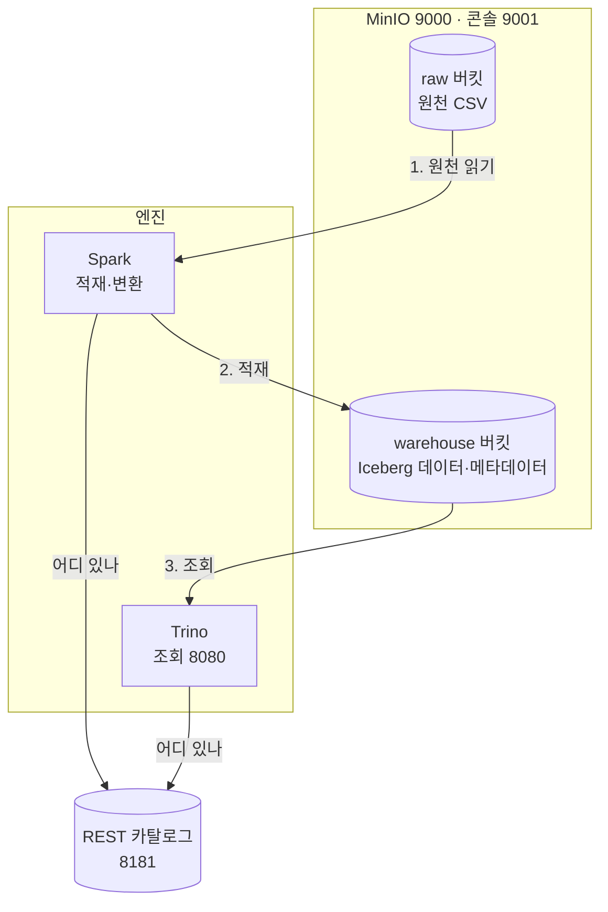

# 4주차 산출물 — 레이크하우스 아키텍처

## 1. 구성
| 구성 요소 | 역할 | 포트 | 없으면 |
|---|---|---|---|
| MinIO | 파일을 담는 오브젝트 스토리지 | 9000·9001 | 저장할 곳이 없다 |
| Iceberg | 파일 묶음을 테이블처럼 다루는 포맷 | — | 무엇이 현재 상태인지 모른다 |
| REST 카탈로그 | 테이블 → 최신 메타데이터 위치 | 8181 | 엔진끼리 같은 테이블을 못 본다 |
| Spark | 적재·변환 (MERGE) | — | 대량 쓰기를 할 수 없다 |
| Trino | 대화형 조회·집계 | 8080 | 빠른 분석 질의가 어렵다 |

## 2. 데이터 흐름
1. 원천 CSV가 raw 버킷에 도착 (랜딩 존)
2. Spark가 s3a로 읽어 정제 (형 변환 · 불량 제거 · 키별 최신 한 행)
3. MERGE INTO로 Iceberg 테이블에 멱등 적재
4. 커밋 시점에 카탈로그 포인터가 바뀌며 비로소 보임
5. Trino가 같은 카탈로그를 통해 조회·집계

## 3. 검증한 것
- Trino INSERT → Spark에서 즉시 조회됨 (order_id 8 추가 후 양쪽 모두 7행)
- Spark ALTER/UPDATE → Trino DESCRIBE에 반영됨 (memo 컬럼, order_id 4 = vip)
- 두 엔진의 스냅샷 개수가 정확히 일치 (Spark 11 · Trino 11)

## 4. 한계와 다음 단계
- 랜딩 존 전체를 매번 다시 읽는다 → 날짜 파티션으로 개선 필요
- 파이프라인을 손으로 실행한다 → 8주차 Airflow로 스케줄링
- 테이블에 컬럼(memo)을 추가한 뒤에는 원천 CSV에 그 컬럼이 없어 etl_orders.py의 MERGE가 UNRESOLVED_COLUMN 오류로 실패한다 → 없는 컬럼을 NULL로 채우거나 컬럼을 명시한 MERGE로 바꿔야 한다
- daily_sales는 CTAS로 한 번 만든 뒤 갱신되지 않는다 → orders에는 8/4 주문(order_id 8)이 있는데 daily_sales에는 8/4 행이 없다. 집계 테이블을 다시 만들거나 MERGE로 갱신하는 단계가 필요하다
